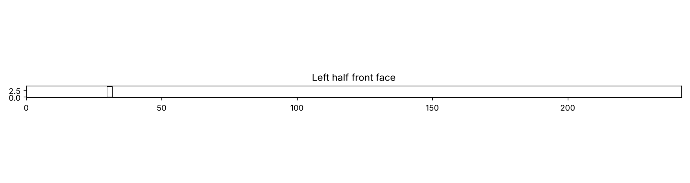
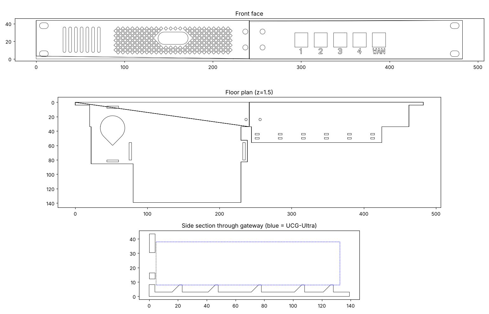

# UCG-Ultra 1U Rack Mount

A 3D-printable 1U, 19" rack mount for the UniFi **Cloud Gateway Ultra (UCG-Ultra)**, with:

- A diamond-mesh front grille with an opening for the gateway's display
- A bay for a 5015 USB blower fan that pushes air through a channel under the gateway
- 5 keystone cut-outs (labelled 1, 2, 3, 4, WAN) for user-supplied keystone jacks
- Patch-cable zip-tie anchors and a hook-and-loop strap to hold the gateway
- A two-piece body joined by a splice bracket, so each part fits a 220 × 220 mm bed

The design is fully parametric (Python + [manifold3d](https://github.com/elalish/manifold)).




## Files

| File | What it is |
|---|---|
| `stl/UCG-Ultra_rack_LEFT.stl` | Left half: ear, fan bay, gateway tray, mesh grille |
| `stl/UCG-Ultra_rack_RIGHT.stl` | Right half: keystones, cable anchors, ear |
| `stl/UCG-Ultra_rack_SPLICE.stl` | Bracket that joins the two halves |
| `ucg_rack.py` | Parametric source; re-run to regenerate the STLs into `out/` |
| `docs/render_sections.py` | Draws section views for checking changes |

The STLs are already in print orientation: front face down, turned 45° to fit a 220 mm bed (tested for the Flashforge Adventurer 5M).

## Parts list

Amazon links for every part are in [PARTS.md](PARTS.md).

### Electronics
| Qty | Part | Notes |
|---|---|---|
| 1 | 5015 blower fan, 5 V USB | 50 × 50 × 15 mm |
| 1 | USB-A power source | USB power strip or 5 V charger. The UCG-Ultra has no spare USB port. |
| 5 | Cat6 keystone jacks | Standard size |
| 5 | Cat6 patch cables, 0.3 m (1 ft) | Slim cables bend more easily |

### Hardware
| Qty | Part | Notes |
|---|---|---|
| 8 | M3 heat-set inserts, ~4 mm long | Go in the splice bracket (4.1 mm holes) |
| 8 | M3 × 8 mm countersunk screws (DIN 7991) | 4 through the front panel, 4 through the floor |
| 4 | M6 cage nuts and screws | Usually included with the rack |
| 4 | M6 washers | Under the rack screws, to protect the plastic |

### Ties and straps
| Qty | Part | Notes |
|---|---|---|
| 1 | Zip tie, 200 mm or longer | Holds the fan |
| 6 | Small zip ties, 4.8 mm wide or narrower | Patch-cable anchors |
| 1 | Hook-and-loop strap, 20 mm wide or less, ~45 cm | Holds the gateway |

### Printing
| Qty | Part | Notes |
|---|---|---|
| ~300 g | PETG filament | Preferred over PLA for heat and creep resistance |

## Printing

- **Material:** PETG
- **Walls:** 4. Infill 20–30%.
- **Bed:** textured PEI with a thin layer of glue stick as release, plus a brim
- **Elephant's foot compensation:** ~0.15 mm, so the keystone holes aren't tight at the front
- **Avoid crossing walls:** on, to stop strings across the mesh
- **Bridges:** ~25 mm/s with full fan
- **Supports:** none needed

Before the full print, test-print a small slice with the display opening and one keystone hole to check the fit.

## Assembly

1. Press the 8 heat-set inserts into the splice bracket (~220–230 °C).
2. Butt the two halves together, then fit the bracket behind the seam with 8 × M3 × 8 countersunk screws.
3. Snap the keystone jacks into the right half from behind.
4. Put the fan in its bay with the outlet facing the gateway, and secure it with the long zip tie. Route its cable through the notch in the rear wall.
5. Drop the gateway into the tray, display facing the grille, and strap it down.
6. Connect the patch cables from the gateway's rear ports to the keystones, and tie them to the anchors.
7. Install the gateway before racking, or leave the U above it empty, because it drops in from the top.
8. Rack it with M6 screws and washers.

## Customising

Edit the parameters at the top of `ucg_rack.py` and run it:

```bash
pip install manifold3d trimesh numpy
python3 ucg_rack.py
```

| Parameter | What it controls |
|---|---|
| `GX` | Where the gateway sits across the panel |
| `CLR` | Clearance around the gateway |
| `RISE` | Air channel under the gateway |
| `KS_W`, `KS_H`, `KS_WALL` | Keystone cut-out size and wall thickness at the clip |
| `KS_LABELS` | Port labels |
| `DISP_W`, `DISP_H`, `DISP_Z` | Display opening size and height |
| `DIA`, `RIB` | Diamond size and rib width |
| `FAN`, `FAN_H` | Fan pocket size |

## Reference dimensions

- **UCG-Ultra:** 141.8 × 127.6 × 30 mm (Ubiquiti datasheet)
- **Panel:** 482.6 × 43.6 mm (1U minus 0.85 mm clearance), EIA ear holes at 465.1 mm centres
- **Depth behind the rails:** 139 mm (about 180 mm including cables). Fits racks 9" (229 mm) deep or more.

## Notes

This is an original design, not a copy of any commercial product. UniFi and UCG-Ultra are trademarks of Ubiquiti Inc.
