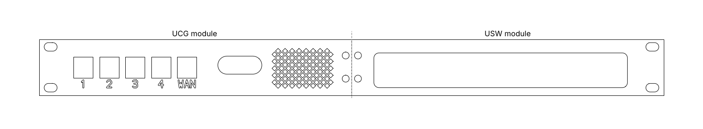
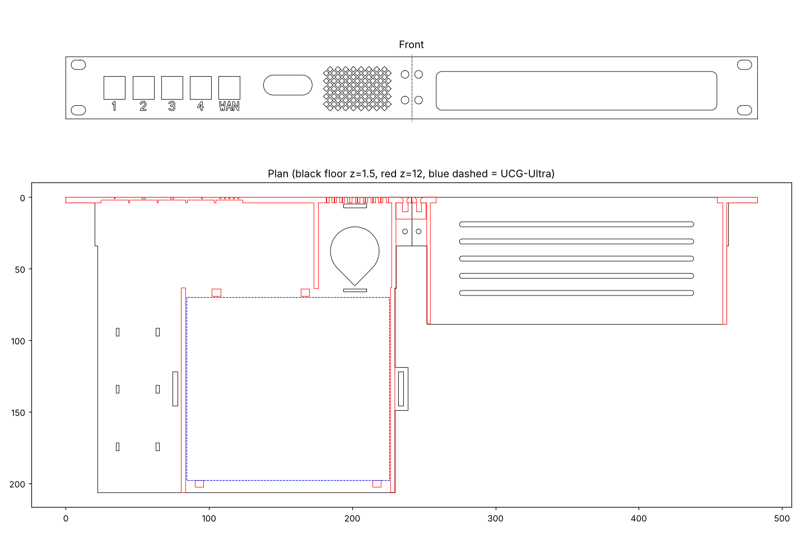

# Modular Version: UCG-Ultra + USW-Ultra

Two half-width modules that bolt together into one 1U, 19" panel:

- **UCG module (left):** UniFi UCG-Ultra, 5 front keystones (labelled 1, 2, 3, 4, WAN), a display opening, and a 5015 blower fan behind a diamond mesh that blows air under the gateway
- **USW module (right):** UniFi USW-Ultra PoE switch, with its 8 ports facing forward through a window in the panel

## Files

| File | What it is |
|---|---|
| `stl/UCG_module.stl` | Left module: ear, keystones, fan bay, gateway tray |
| `stl/USW_module.stl` | Right module: ear, USW-Ultra tray with snap rails, port window |
| `stl/SPLICE.stl` | Bracket that joins the two modules |
| `modules.py` | Parametric source; re-run to regenerate the STLs into `out/` |

The STLs are already in print orientation: front face down, turned 45° to fit a 220 × 220 mm bed. The UCG module prints **206 mm tall**, which fits the Adventurer 5M's 220 mm height.

## How the UCG module is laid out

- **Gateway:** sits **66 mm behind the panel**. That leaves room in front of it for the 5 keystones and the plugs of the patch cables behind them.
- **Display:** visible through its own opening, now set back from the panel.
- **Patch cables:** run from the gateway's rear ports, forward along the left side, to the keystones. Three zip-tie anchors along that side keep them tidy.
- **Fan:** lies flat in front of the gateway's right half, behind the mesh. Point its outlet toward the back so it blows into the channel under the gateway, along the five ribs and out the back.

## Connecting to the switch

Plug a short front jumper from keystone **1** (one of the UCG-Ultra's LAN ports) into any USW-Ultra port. The modem still connects to the **WAN** keystone, from the front.

## How the USW-Ultra is held

The switch drops into its tray from the top and snaps under small lips on both rails. Low stops at the back keep it from sliding rearward. To remove it, flex one rail outward slightly and lift.

## Parts

Everything in [../PARTS.md](../PARTS.md) applies, except the power-switch parts, plus:

| Change | Part | Notes |
|---|---|---|
| Add | UniFi USW-Ultra | 203 × 76 × 33 mm |
| Add | USW-Ultra power | A PoE++ source or its separate 54 V adapter |
| Add | USB-A power source for the fan | USB power strip or 5 V charger |
| Change | Patch cables: 5 × **0.5 m** (1.5 ft) slim Cat6 | Longer than before, because they loop forward along the gateway |
| Add | 1 × short Cat6 jumper | Front: keystone 1 → USW-Ultra |
| Remove | The power button, USB-C breakouts and USB-A adapter | This version has no power button |
| Ties | 1 zip tie for the fan plus 3 small ones for the cable anchors | |

## Printing and assembly

Print settings are the same as the full version: PETG, 4 walls, brim, textured plate, no supports.

1. Press the 8 heat-set inserts into the splice bracket.
2. Butt the two modules together and screw the bracket behind the seam.
3. Snap the 5 keystones into the UCG module from behind.
4. Put the fan in its bay, outlet facing the gateway, and zip-tie it down.
5. Drop in the UCG-Ultra, front against its two front stops, and strap it down.
6. Connect the patch cables (gateway ports 1–4 and WAN → matching keystones), and tie them to the anchors.
7. Snap the USW-Ultra into its tray, ports facing the window.
8. Rack it, then add the front jumper from keystone 1 to the switch.

## Check before printing

- **Rack depth:** the UCG module reaches about **210 mm** behind the rails, or roughly 245 mm with plugs. Set your CNAweb rack to **10" or deeper**.
- **USW-Ultra port window:** it's sized to the switch's 203 × 33 mm long face, assuming the ports are on that face. Confirm on your unit.
- **Snap rails:** print the USW module first and test the fit. Adjust `US_LIP` or `US_CLR` if it's too tight or too loose.

## Customising

| Parameter | What it controls |
|---|---|
| `GYF` | How far back the gateway sits |
| `KS_PITCH`, `KS_X0`, `KS_LABELS` | Keystone spacing, position and labels |
| `FX0`, `FY0` | Fan position |
| `MESH_X0`, `MESH_X1` | Mesh area |
| `US_L`, `US_D`, `US_H`, `US_CLR`, `US_LIP`, `US_WIN` | USW-Ultra tray and window |
